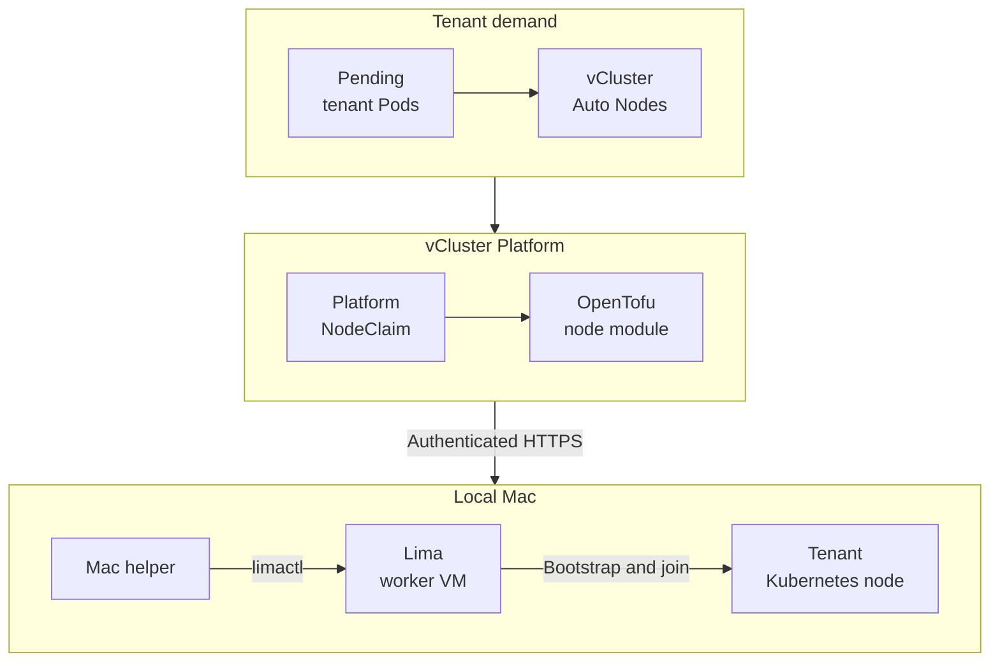
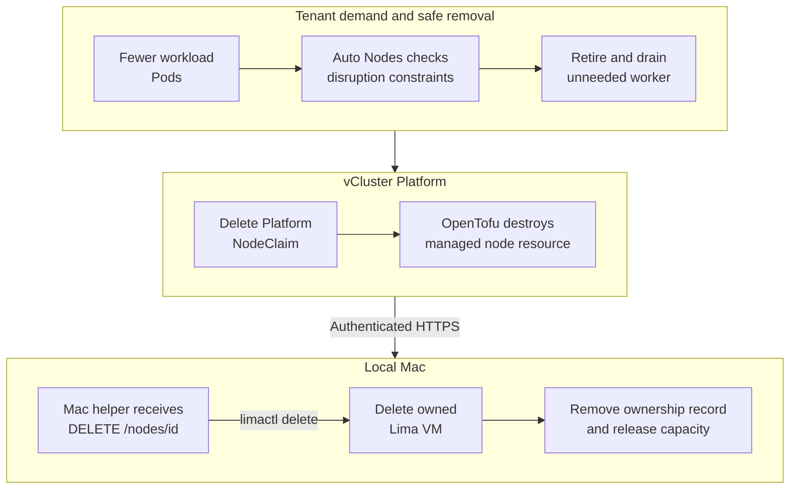

<p align="center">
  
</p>

# Lima NodeProvider for vCluster

A community Lima NodeProvider for vCluster Platform that dynamically provisions and removes local private-worker VMs on macOS.

[](https://github.com/juanroldan1989/vcluster-lima-nodeprovider/actions/workflows/test.yml)
[](ROADMAP.md)
[](https://github.com/juanroldan1989/vcluster-lima-nodeprovider/actions/workflows/lint.yml)
[](https://github.com/juanroldan1989/vcluster-lima-nodeprovider/actions/workflows/security.yml)

[Goals](#goals) · [Architecture](#architecture) · [Roadmap](ROADMAP.md) · [Contributing](CONTRIBUTING.md) · [Security](SECURITY.md)

<a name="project-status"></a>

## 📌 Project status

**Early development.** The repository contains the authenticated helper, guest bootstrap adapter, offline tests and automated checks. Platform manifests, the OpenTofu module and installation tooling are not yet included. There is no packaged release or end-to-end installer yet.

A separate local prototype has demonstrated worker creation, registration, multi-tenant scale-up and automatic deletion of empty workers and their Lima VMs. Those results establish the starting point for this project, not a compatibility guarantee for this repository. See the [roadmap](ROADMAP.md) for the migration and release milestones.

This is an independent community project, maintained by [Juan Roldan](https://github.com/juanroldan1989). It is not an official vCluster or Lima distribution.

<a name="why-this-project"></a>

## 💡 Why this project?

vCluster Auto Nodes can request private workers as application demand grows. Lima provides Linux VMs on a local machine. This project connects the two so platform engineers can explore the private-worker lifecycle locally, without provisioning cloud worker VMs.

The important execution boundary is between OpenTofu running inside vCluster Platform and `limactl` running under the Mac user's account. A local HTTPS helper bridges that boundary and associates each VM with its tenant and NodeClaim.

The intended audience is platform engineers, vCluster users and people building reproducible local Kubernetes labs.

<a name="goals"></a>

## 🎯 Goals

- Provision Lima VMs in response to vCluster Platform NodeClaims and register them as tenant workers.
- Help platform engineers learn dynamic VM provisioning on their own machine without cloud VM charges.
- Support workload-driven scale-up and removal of unneeded workers through vCluster Auto Nodes.
- Preserve stable worker identity across retries and delete only VMs owned by this integration.
- Provide explicit worker sizing and shared capacity controls suitable for a local Mac.
- Make bootstrap progress, failures, recovery and cleanup understandable.
- Provide a reproducible installation, a two-tenant scaling example and documented compatibility.

<a name="scope"></a>

## 🧭 Scope

The initial implementation targets macOS on Apple Silicon, Lima's VZ backend and Ubuntu ARM64 guests. Broader platform support requires its own implementation and validation.

The first release focuses on a single Mac and trusted local development. Production hosting, a general-purpose remote VM service, multiple Mac hosts and support for every Lima configuration are outside the initial scope.

Auto Nodes and its built-in Karpenter make scheduling and consolidation decisions. This integration supplies the Lima worker lifecycle; it does not implement a new autoscaler. Tenant application connectivity, shared model endpoints and persistent storage require their own configuration.

<a name="architecture"></a>

## 🏗️ Architecture

The architecture below shows the complete integration. The local helper and guest bootstrap adapter are implemented; Platform wiring is not yet included:



| Component | Responsibility |
| --- | --- |
| vCluster Auto Nodes | Decide when worker capacity is needed or can be removed. |
| vCluster Platform | Manage NodeClaims and execute the provider's OpenTofu module. |
| OpenTofu module | Translate resource lifecycle operations into helper API requests. |
| Mac helper | Manage owned Lima VMs, enforce local capacity and execute worker bootstrap. |
| Lima worker VM | Run the Kubernetes worker components and tenant workloads. |

### Scale-down follows the managed lifecycle in reverse

Auto Nodes retires a worker, Platform destroys its managed resource and the helper deletes the associated Lima VM and ownership record. System Pods and disruption constraints can retain workers after application demand falls.



<a name="getting-started"></a>

## 🚀 Getting started

You can exercise the helper locally with Python 3.11 or newer, without installing Lima or vCluster Platform:

```bash
python3 -m unittest discover -s tests -v
python3 scripts/check_repository.py
```

The tests use temporary state and a fake Lima executable. They do not start VMs, execute guest bootstrap commands or contact a live cluster. Read the [local helper guide](docs/local-helper.md) for the API, ownership model, configuration and bootstrap boundaries.

Full installation instructions are not yet available. Review the [roadmap](ROADMAP.md), discuss a feature through [GitHub Issues](https://github.com/juanroldan1989/vcluster-lima-nodeprovider/issues), or follow the [contribution guide](CONTRIBUTING.md).

The intended runtime prerequisites are a supported Mac, Lima, a host Kubernetes cluster and vCluster Platform with access to the required Auto Nodes and Terraform NodeProvider features. This project does not install or grant licenses for those upstream products.

The prototype was exercised with Platform 4.12.1, vCluster 0.37.1 and Lima 2.1.0 on macOS ARM64. These are historical prototype results, not a live compatibility check of the extracted helper. A supported version matrix and fresh-install validation remain release milestones.

<a name="checks"></a>

## ✅ Checks

| Badge | What it covers |
| --- | --- |
| Test | The offline helper suite on Python 3.11 through 3.14, using fake Lima commands and mocked guest operations. |
| Acceptance | Planned: real worker creation, registration, scale-down and VM cleanup after the Platform integration is available. |
| Lint | Ruff checks plus source syntax, local documentation links and text formatting. |
| Security | Bandit scans the helper for medium- and high-severity Python findings. This is a static check, not a security certification. |

The test, lint and security badges display this repository's latest workflow result on `main`. They will show a result after the workflows are pushed and run on GitHub; local checks do not set their status. The acceptance badge remains marked planned until live acceptance tests exist. See [CONTRIBUTING.md](CONTRIBUTING.md#running-lint-and-security-checks) for local commands.

<a name="related-projects"></a>

## 🔗 Related projects

- [vCluster](https://github.com/loft-sh/vcluster): tenant Kubernetes clusters and Auto Nodes.
- [Lima](https://github.com/lima-vm/lima): the local Linux VM runtime.
- [Mastercard/restapi](https://github.com/Mastercard/terraform-provider-restapi): the generic Terraform REST client used by the prototype to call the Mac helper.

<a name="community"></a>

## 🤝 Community

Contributions and questions are welcome through this repository's [issues](https://github.com/juanroldan1989/vcluster-lima-nodeprovider/issues) and pull requests. Read [CONTRIBUTING.md](CONTRIBUTING.md) and the [Code of Conduct](CODE_OF_CONDUCT.md) before participating. Follow [SECURITY.md](SECURITY.md) for sensitive reports.

<a name="license"></a>

## 📄 License

Licensed under the [Apache License, Version 2.0](LICENSE). Upstream dependencies retain their own licenses.
