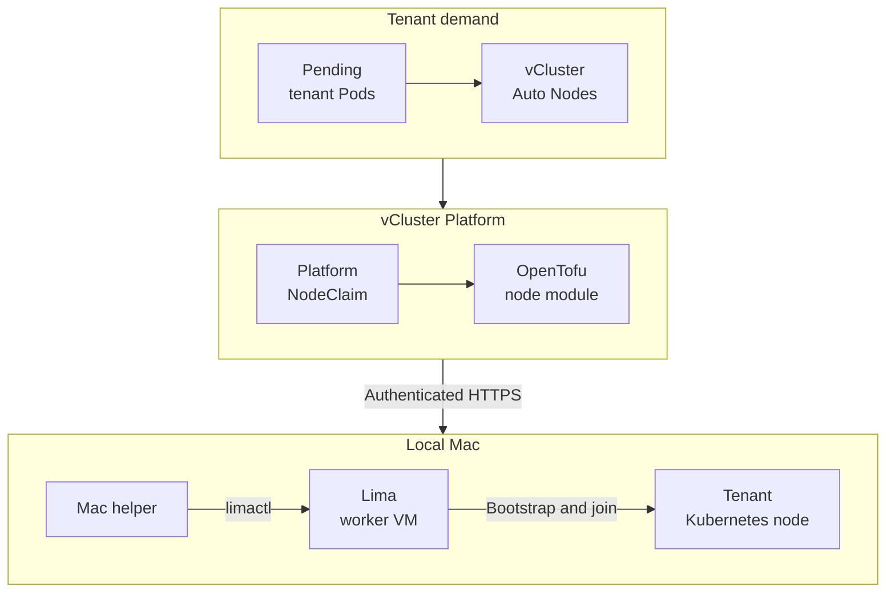
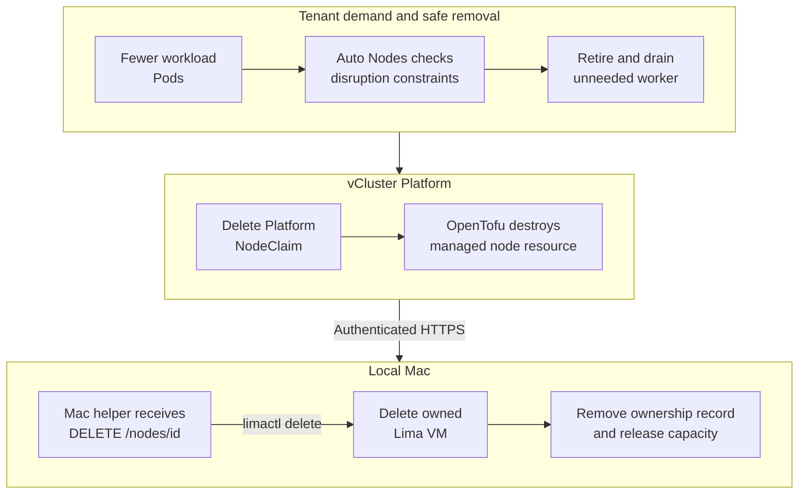

<p align="center">
  
</p>

# Lima NodeProvider for vCluster

A community Lima NodeProvider for vCluster Platform that dynamically provisions and removes local private-worker VMs on macOS.

[](https://github.com/juanroldan1989/vcluster-lima-nodeprovider/actions/workflows/test.yml)
[](ROADMAP.md)
[](https://github.com/juanroldan1989/vcluster-lima-nodeprovider/actions/workflows/lint.yml)
[](https://github.com/juanroldan1989/vcluster-lima-nodeprovider/actions/workflows/security.yml)

[Goals](#goals) · [Architecture](#architecture) · [Autoscaling example](examples/autoscaling/README.md) · [Screenshots](#screenshot-showcase) · [Roadmap](ROADMAP.md) · [Contributing](CONTRIBUTING.md) · [Security](SECURITY.md)

<a name="project-status"></a>

## 📌 Project status

**Early development.** The repository contains the authenticated helper, guest bootstrap adapter, OpenTofu node module, Platform manifests and setup commands. An [installation guide](docs/installation.md) covers provider deployment, tenant creation and managed cleanup. There is no packaged release yet.

Live validation provisioned workers in two independent tenants, scaled from two to four managed VMs, then returned to two as application demand fell. Tenant deletion removed the remaining VMs and ownership records. The [two-tenant autoscaling example](examples/autoscaling/README.md) provides the workload, shared capacity budget, observation commands and managed teardown instructions. See the [worker validation record](docs/installation.md#validation-record), [autoscaling validation record](docs/autoscaling-validation.md) and [roadmap](ROADMAP.md) for evidence and remaining release work.

This is an independent community project, maintained by [Juan Roldan](https://github.com/juanroldan1989). It is not an official vCluster or Lima distribution.

<a name="why-this-project"></a>

## 💡 Why this project?

vCluster Auto Nodes can request private workers as application demand grows. Lima provides Linux VMs on a local machine. This project connects the two so platform engineers can explore the private-worker lifecycle locally, without provisioning cloud worker VMs.

The important execution boundary is between OpenTofu running inside vCluster Platform and `limactl` running under the Mac user's account. A local HTTPS helper bridges that boundary and associates each VM with its tenant and NodeClaim.

The intended audience is platform engineers, vCluster users and people building reproducible local Kubernetes labs.

<a name="goals"></a>

## 🎯 Goals

- Provision Lima VMs in response to vCluster Platform NodeClaims and register them as tenant workers.
- Help platform engineers learn dynamic VM provisioning on their own machine without cloud VM charges.
- Support workload-driven scale-up and removal of unneeded workers through vCluster Auto Nodes.
- Preserve stable worker identity across retries and delete only VMs owned by this integration.
- Provide explicit worker sizing and shared capacity controls suitable for a local Mac.
- Make bootstrap progress, failures, recovery and cleanup understandable.
- Provide a reproducible installation, a two-tenant scaling example and documented compatibility.

<a name="scope"></a>

## 🧭 Scope

The initial implementation targets macOS on Apple Silicon, Lima's VZ backend and Ubuntu ARM64 guests. Broader platform support requires its own implementation and validation.

The first release focuses on a single Mac and trusted local development. Production hosting, a general-purpose remote VM service, multiple Mac hosts and support for every Lima configuration are outside the initial scope.

Auto Nodes and its built-in Karpenter make scheduling and consolidation decisions. This integration supplies the Lima worker lifecycle; it does not implement a new autoscaler. Tenant application connectivity, shared model endpoints and persistent storage require their own configuration.

<a name="architecture"></a>

## 🏗️ Architecture

The architecture below shows the provisioning path implemented by this repository:



| Component | Responsibility |
| --- | --- |
| vCluster Auto Nodes | Decide when worker capacity is needed or can be removed. |
| vCluster Platform | Manage NodeClaims and execute the provider's OpenTofu module. |
| OpenTofu module | Translate resource lifecycle operations into helper API requests. |
| Mac helper | Manage owned Lima VMs, enforce local capacity and execute worker bootstrap. |
| Lima worker VM | Run the Kubernetes worker components and tenant workloads. |

### Scale-down follows the managed lifecycle in reverse

Auto Nodes retires a worker, Platform destroys its managed resource and the helper deletes the associated Lima VM and ownership record. System Pods and disruption constraints can retain workers after application demand falls.



<a name="screenshot-showcase"></a>

## 📸 Screenshot showcase

The following slots reserve space for captures from a real two-tenant run. The [autoscaling walkthrough](examples/autoscaling/README.md) contains the full capture sequence, planned filenames and capture metadata.

> **Screenshot placeholder — Lima NodeProvider**
>
> Show the provider in Platform's NodeProviders view with its ID, availability and 1 CPU / 2Gi worker node type visible.
>
> Planned image: `docs/images/screenshots/platform-nodeprovider.png` · [Capture details](examples/autoscaling/README.md#platform-nodeprovider).

> **Screenshot placeholder — Default project tenants**
>
> Show lima-demo-a and lima-demo-b running in the Default project after the baseline workers and nginx replicas are Ready.
>
> Planned image: `docs/images/screenshots/default-project-tenants.png` · [Capture details](examples/autoscaling/README.md#default-project-tenants).

> **Screenshot placeholder — Four managed Lima VMs**
>
> Capture limactl list on the Mac after scale-up. Keep all four mapped VM names and their Running state legible.
>
> Planned image: `docs/images/screenshots/lima-vms-scaled-up.png` · [Capture details](examples/autoscaling/README.md#lima-vms-scaled-up).

> **Screenshot placeholder — Two managed Lima VMs remain**
>
> Capture limactl list after scale-down. Confirm the two retired VM names are absent and the retained names match the workers still shown in Platform.
>
> Planned image: `docs/images/screenshots/lima-vms-scaled-down.png` · [Capture details](examples/autoscaling/README.md#lima-vms-scaled-down).

<a name="getting-started"></a>

## 🚀 Getting started

### 1. Check the prerequisites

| Component | Requirement |
| --- | --- |
| Mac | macOS on Apple Silicon. |
| Local tools | Python 3.11 or newer, OpenSSL and Lima. |
| Host cluster | A running Kubernetes cluster accessible with `kubectl`. |
| vCluster Platform | Auto Nodes and Terraform NodeProvider features available under your upstream license or trial. |
| Platform access | Administrator permissions for installation and a logged-in vCluster CLI. |

See the [installation prerequisites](docs/installation.md#prerequisites) for networking and project access requirements. This project does not install or grant licenses for upstream products.

### 2. Prepare and deploy the provider

From the repository root:

```bash
./setup.sh prepare --platform-host YOUR-PLATFORM-HOSTNAME
./setup.sh start
./setup.sh check
./setup.sh deploy
./setup.sh status
```

Use the hostname from your Platform browser URL for `YOUR-PLATFORM-HOSTNAME`, without `https://` or a path. For example, `https://example.loft.host/clusters` becomes `example.loft.host`.

These commands prepare private credentials, start the helper, verify Platform connectivity and install a NodeProvider plus a private-worker tenant template.

The [installation guide](docs/installation.md#prepare-and-deploy) explains each step, connection settings, worker sizing and capacity limits.

### 3. Create your first tenant

Follow [Create a tenant and observe a worker](docs/installation.md#create-a-tenant-and-observe-a-worker) to allow the template in your project, create a tenant and confirm its worker reaches Kubernetes `Ready`.

To explore workload-driven scale-up and worker removal in two independent tenants, follow the [autoscaling example](examples/autoscaling/README.md). It uses one shared provider with a four-worker budget.

Provider deployment does not create a tenant or VM. After testing, remove the complete prepared installation with:

```bash
./setup.sh teardown
```

Use `./setup.sh teardown --dry-run` to preview the affected resources. See [Cleanup before removing Platform](docs/installation.md#cleanup-before-removing-platform) for cleanup order and reinstallation with the default names. For setup, provisioning, scaling or cleanup issues, use the [troubleshooting scenario index](docs/troubleshooting.md#scenario-index).

### Optional: run the offline checks

You can exercise the helper with Python 3.11 or newer, without installing Lima or vCluster Platform:

```bash
python3 -m unittest discover -s tests -v
python3 scripts/check_repository.py
```

The tests use temporary state and a fake Lima executable. They do not start VMs, execute guest bootstrap commands or contact a live cluster. Read the [local helper guide](docs/local-helper.md) for the API, ownership model, configuration and bootstrap boundaries.

### Validation and compatibility

The original prototype used Platform 4.12.1, vCluster 0.37.1 and Lima 2.1.0 on macOS ARM64. For this repository's real-worker smoke test and module integration results, see the [validation record](docs/installation.md#validation-record). A supported version matrix remains a release milestone.

Review the [roadmap](ROADMAP.md) for remaining work or follow the [contribution guide](CONTRIBUTING.md) to help.

<a name="checks"></a>

## ✅ Checks

| Badge | What it covers |
| --- | --- |
| Test | The offline suite on Python 3.11 through 3.14 plus a real OpenTofu/HTTPS lifecycle test using fake Lima. |
| Acceptance | Planned: automated real-worker creation, registration, scale-down and VM cleanup. |
| Lint | Ruff checks plus source syntax, local documentation links and text formatting. |
| Security | Bandit scans the helper for medium- and high-severity Python findings. This is a static check, not a security certification. |

The test, lint and security badges display this repository's latest workflow result on `main`. They will show a result after the workflows are pushed and run on GitHub; local checks do not set their status. The acceptance badge remains marked planned until automated live acceptance tests exist. See [CONTRIBUTING.md](CONTRIBUTING.md#running-lint-and-security-checks) for local commands.

<a name="related-projects"></a>

## 🔗 Related projects

- [vCluster](https://github.com/loft-sh/vcluster): tenant Kubernetes clusters and Auto Nodes.
- [Lima](https://github.com/lima-vm/lima): the local Linux VM runtime.
- [Mastercard/restapi](https://github.com/Mastercard/terraform-provider-restapi): the generic Terraform REST client used by the node module to call the Mac helper.

<a name="community"></a>

## 🤝 Community

Contributions and questions are welcome through this repository's [issues](https://github.com/juanroldan1989/vcluster-lima-nodeprovider/issues) and pull requests. Read [CONTRIBUTING.md](CONTRIBUTING.md) and the [Code of Conduct](CODE_OF_CONDUCT.md) before participating. Follow [SECURITY.md](SECURITY.md) for sensitive reports.

<a name="license"></a>

## 📄 License

Licensed under the [Apache License, Version 2.0](LICENSE). Upstream dependencies retain their own licenses.
