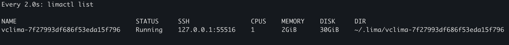

# Autoscaling validation record

This record accompanies the [tenant autoscaling example](../examples/autoscaling/README.md). It documents workload-driven scale-up and occupied-worker consolidation for `lima-demo-a`. Hosted acceptance automation and a supported version matrix remain release work.

## Occupied-worker consolidation

**Test date:** 2026-11-07. **Result: passed.**

| Component | Tested configuration |
| --- | --- |
| Host | macOS ARM64, Lima 2.1.0 |
| vCluster Platform | 4.12.4 |
| Tenant chart / Kubernetes | 0.37.4 / v1.36.5 |
| Tenant / project | `lima-demo-a` / `default` |
| Provider / pool | `lima-local` / `lima-workers-dynamic` |
| Worker profile | 1 CPU / 2Gi RAM / 30Gi disk |
| Shared / tenant caps | Four / two workers |
| Canonical type | `lima-local.lima-local-1cpu-2gi` |

The test used newly provisioned workers with matching provider-qualified type labels.

### Test sequence

1. Confirmed one Ready nginx replica and one fresh Ready worker.
2. Scaled the Deployment to two replicas. A second fresh Lima VM joined and both workers had matching canonical type labels.
3. Used temporary [Pod deletion-cost annotations](https://kubernetes.io/docs/concepts/workloads/controllers/replicaset/#pod-deletion-cost) to control placement during scale-down: reducing to one replica removed nginx from the original worker and kept nginx on the newer worker. The original worker still hosted CoreDNS, konnectivity-agent and local-path-provisioner, so both workers contained non-DaemonSet Pods.
4. Observed Karpenter evict nginx from the newer worker and reschedule it on the retained worker. It then removed the retired Node, Platform NodeClaim, ownership record and actual Lima VM automatically.
5. Verified nginx and the system Deployments were Ready. Removed the temporary deletion-cost annotation if it remained on a surviving test Pod.

| Stage | Observed at | Ready nginx replicas | Ready workers | Platform claims | Ownership records | Managed VMs |
| --- | --- | --- | --- | --- | --- | --- |
| Baseline | 0.9s | 1 | 1 | 1 | 1 | 1 |
| Scaled up | 121.0s | 2 | 2 | 2 | 2 | 2 |
| Occupied-worker scale-down | 185.1s | 1 | 1 | 1 | 1 | 1 |

Times are relative to the start of this test and were sampled roughly every eight seconds. They do not establish a removal deadline.

| Worker VM | Platform claim | Result |
| --- | --- | --- |
| `vclima-7f27993df686f53eda15f796` | `lima-demo-a-9d445` | Retained; nginx was rescheduled here. |
| `vclima-db19125756e6ca3e1d5c52d3` | `lima-demo-a-wh2xc` | Removed automatically; exact VM name absent from Lima inventory. |

**Validation scope:** One tenant in the observed environment. The desired replica count went from one to two to one; no zero-replica fallback, manual Node/NodeClaim deletion or manual VM deletion was used during this test. This extends the earlier empty-worker evidence without claiming that every scheduling or disruption constraint permits consolidation. The final state contained one Ready worker and one Ready nginx replica.

### Inventory after scale-down

*After scale-down, one Lima worker VM remains Running with 1 CPU, 2GiB RAM and a 30GiB virtual disk.*

The retained VM matches the test results above.

## Screenshot references

The [illustrated walkthrough](../examples/autoscaling/README.md) follows lima-demo-a through creation, provisioning, scale-up, scale-down and teardown. Its [capture metadata](../examples/autoscaling/README.md#screenshot-capture-metadata) lists the tested versions and worker configuration.

## Evidence and scope

The test checks application Ready replica counts, tenant Node readiness, Platform NodeClaims, helper ownership records and actual Lima VM inventory. Credential files, OpenTofu state, join payloads and guest logs are excluded from this public record.

The helper serializes provisioning operations. Timing from one run does not establish a provisioning guarantee. See [scale-down troubleshooting](troubleshooting.md#if-an-occupied-worker-remains) for type-label checks and disruption constraints.

## Earlier shared-capacity validation

A separate live run on 2026-11-01 validated multiple tenants sharing one provider on macOS ARM64 with Lima 2.1.0, Platform 4.12.4 and tenant chart 0.37.1. Its aggregate managed worker count rose from two to four, returned to two through automatic empty-worker removal, then reached zero after tenant teardown. The matching Platform claims, helper ownership records and exact VM names were checked at each stage.

The original observations converged at 254s for baseline, 456s for scale-up, 563s for scale-down and 596s for tenant teardown, measured from the start of that run. They were sampled roughly every 20 seconds. Two manually managed VMs remained outside that lifecycle. These historical observations support shared-capacity behavior; the walkthrough uses the single tenant shown in the current screenshots.
