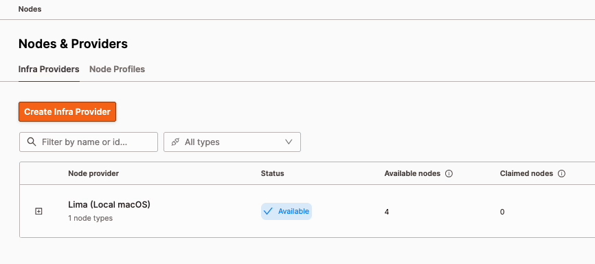
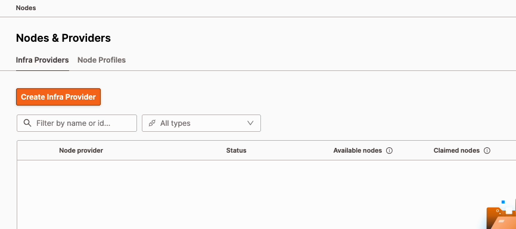

# Screenshot and recording assets

The [illustrated autoscaling walkthrough](../../../examples/autoscaling/README.md) places the captures beside their setup, provisioning, scaling and cleanup steps. The [README showcase](../../../README.md#screenshot-showcase) uses a smaller selection. The catalog describes the visible resource state in each capture.

## Capture scope

- Captured on **2026-11-07**, Europe/Amsterdam, using tenant `lima-demo-a` in the Default project.
- The captures cover provider setup, tenant provisioning, scale-up, scale-down and teardown.
- Use [tenant-template.yaml.tmpl](../../../platform/tenant-template.yaml.tmpl) for the current template configuration.
- The two reference copies identified below are exact duplicates of baseline files. They are retained for reference and are not independent after-scale-down evidence.
- Two dimmed provisioning images received pixel-based brightness correction. Their UI text, layout and dimensions were preserved.

See the [capture metadata](../../../examples/autoscaling/README.md#screenshot-capture-metadata) and [validation record](../../autoscaling-validation.md) for versions and verified removal results.

## Asset catalog

| Asset | Description |
| --- | --- |
| [lima-node-provider-shows-0-claimed-nodes.png](lima-node-provider-shows-0-claimed-nodes.png) | The Lima provider is Available with four free worker slots and zero claimed nodes. This idle view was captured after tenant cleanup. |
| [lima-node-provider-shows-1-node-claimed-for-tenant-a.png](lima-node-provider-shows-1-node-claimed-for-tenant-a.png) | One Lima worker is claimed and three of the four shared slots remain available. The expanded row identifies the provider-qualified worker type. |
| [lima-auto-template-list.png](lima-auto-template-list.png) | The installed template targets vCluster 0.37.4 and advertises two 1-CPU / 2Gi workers per tenant within four shared provider slots. |
| [lima-auto-template.png](lima-auto-template.png) | The template view shows the dynamic pool, two-worker limit and VPN settings. Use the generated manifest for the current type selector. |
| [lima-demo-a-tenant-creation-in-progress.png](lima-demo-a-tenant-creation-in-progress.png) | Tenant A is Starting with Auto-Nodes tenancy while Platform creates its control plane. |
| [lima-demo-a-tenant-created.png](lima-demo-a-tenant-created.png) | Tenant A is Running on vCluster 0.37.4 with one worker and Kubernetes v1.36.5. |
| [lima-demo-a-tenant-creation-in-progress-graph-view.png](lima-demo-a-tenant-creation-in-progress-graph-view.png) | The hosted control plane and PVC exist while the first worker claim is pending. Control-plane availability precedes worker readiness. |
| [lima-demo-a-tenant-node-claim-pending.png](lima-demo-a-tenant-node-claim-pending.png) | The Node Claim Pending condition reports provisioning for lima-demo-a-952f2. The control-plane steps have completed while the worker is being prepared. |
| [lima-demo-a-tenant-created-graph-view.png](lima-demo-a-tenant-created-graph-view.png) | The overview connects the hosted control plane and PVC to the Lima Auto Nodes pool. The worker summary reports one Ready worker. |
| [lima-demo-a-node-baseline.png](lima-demo-a-node-baseline.png) | The initial Lima worker is Ready and running Kubernetes v1.36.5. Its name can be matched to the original VM inventory. |
| [lima-demo-a-deployment-baseline.png](lima-demo-a-deployment-baseline.png) | The lima-scale-test Deployment has one Ready and available nginx replica alongside the tenant system Deployments. |
| [lima-demo-a-pods-baseline.png](lima-demo-a-pods-baseline.png) | The baseline nginx Pod is Running and Ready. The Node column shows its placement on the initial Lima worker. |
| [lima-demo-a-deployment-scaled-up.png](lima-demo-a-deployment-scaled-up.png) | The Deployment now requests two replicas, but only one is Ready while additional worker capacity is provisioned. |
| [lima-demo-a-deployment-running-2-replicas.png](lima-demo-a-deployment-running-2-replicas.png) | Scale-up has completed: both desired nginx replicas are Ready and available. |
| [lima-demo-a-tenant-second-pod-scheduled-requires-new-node.png](lima-demo-a-tenant-second-pod-scheduled-requires-new-node.png) | The additional nginx Pod is Pending without an assigned node. Its CPU request cannot fit alongside the original replica on one worker. |
| [lima-demo-a-tenant-graph-view-second-node-claim-triggered.png](lima-demo-a-tenant-graph-view-second-node-claim-triggered.png) | The original worker remains Ready while Auto Nodes requests another worker to satisfy the Pending Pod. |
| [lima-demo-a-tenant-graph-view-second-node-joining.png](lima-demo-a-tenant-graph-view-second-node-joining.png) | The second worker has entered the joining flow. The summary shows one Ready worker and one Pending worker. |
| [lima-demo-a-tenant-graph-view-second-node-claim-completed.png](lima-demo-a-tenant-graph-view-second-node-claim-completed.png) | The worker summary reports two Ready workers after the additional claim completes. |
| [lima-demo-a-tenant-second-node-not-ready.png](lima-demo-a-tenant-second-node-not-ready.png) | The new worker is registered in the tenant but still NotReady. Registration and Kubernetes readiness are separate checkpoints. |
| [lima-demo-a-tenant-second-node-ready.png](lima-demo-a-tenant-second-node-ready.png) | Both worker rows are Ready, with distinct names and internal IP addresses. |
| [lima-demo-a-tenant-second-pod-scheduled-in-new-node.png](lima-demo-a-tenant-second-pod-scheduled-in-new-node.png) | Both nginx replicas are Running and Ready. Their Node column values confirm that each replica uses a different worker. |
| [limactl-list-shows-both-vms-running-for-tenant-a.png](limactl-list-shows-both-vms-running-for-tenant-a.png) | Lima lists the two original worker VMs as Running, each with 1 CPU, 2GiB RAM and a 30GiB virtual disk. |
| [lima-demo-a-deployment-scaled-down.png](lima-demo-a-deployment-scaled-down.png) | The Deployment view shows the reduced one-replica application state with one Ready and available nginx replica. |
| [limactl-list-shows-one-vm-running-for-tenant-a-after-scale-down.png](limactl-list-shows-one-vm-running-for-tenant-a-after-scale-down.png) | After scale-down, one Lima worker VM remains Running with 1 CPU, 2GiB RAM and a 30GiB virtual disk. |
| [lima-demo-a-tenant-second-node-removed-by-karpenter.png](lima-demo-a-tenant-second-node-removed-by-karpenter.png) | Reference copy of lima-demo-a-node-baseline.png. The files are byte-identical; this is a baseline illustration, not a separate removal capture. |
| [lima-demo-a-tenant-second-pod-removed-after-scaled-down.png](lima-demo-a-tenant-second-pod-removed-after-scaled-down.png) | Reference copy of lima-demo-a-pods-baseline.png. The files are byte-identical; this is a baseline illustration, not a separate scale-down capture. |
| [lima-demo-a-tenant-being-terminated.png](lima-demo-a-tenant-being-terminated.png) | Platform shows tenant A as Terminating while its control plane, storage and remaining worker are being cleaned up. |
| [lima-demo-a-tenant-terminated.png](lima-demo-a-tenant-terminated.png) | Tenant A is absent from the Default project after managed tenant deletion completes. |
| [limactl-list-shows-0-vms-running-after-tenant-a-deletion.png](limactl-list-shows-0-vms-running-after-tenant-a-deletion.png) | The selected Lima inventory reports No instance found after tenant deletion, confirming that no VM remains in that inventory. |

## Provider teardown recording

*Watch the 4.2-second recording: the idle provider disappears from Nodes & Providers during full installation teardown. [Open MP4](lima-node-provider-removed-by-teardown-script.mp4) · [Original MOV](lima-node-provider-removed-by-teardown-script.mov).*

*At approximately 3.2 seconds in the recording, the provider row has disappeared. This frame is extracted from the original footage.*

| Asset | Description |
| --- | --- |
| [Original MOV](lima-node-provider-removed-by-teardown-script.mov) | Supplied 4.193-second, 866 × 384 recording. |
| [MP4 playback copy](lima-node-provider-removed-by-teardown-script.mp4) | Same H.264 video stream in an MP4 container; no re-encoding. |
| [Preview frame](lima-node-provider-teardown-poster.png) | First frame, before the provider disappears. |
| [Final provider view](lima-node-provider-after-teardown.png) | Frame at approximately 3.2 seconds, with no provider row. |

## Adding or updating captures

1. Use descriptive filenames and record the tenant, versions, worker profile and actual capture date.
2. Embed images with relative links, useful alt text and a short caption describing the visible state. Use a linked preview for recordings so the same Markdown works in repository views and documentation readers.
3. Keep secrets, kubeconfigs and registration logs out of captures. Preserve original recordings when adding playback copies or still frames.
4. When a file is renamed, update its catalog entry and every consuming document. Keep before/after claims tied to the same resource identities or explain why identities changed.
5. Run `python3 scripts/check_repository.py` and `git diff --check`.
