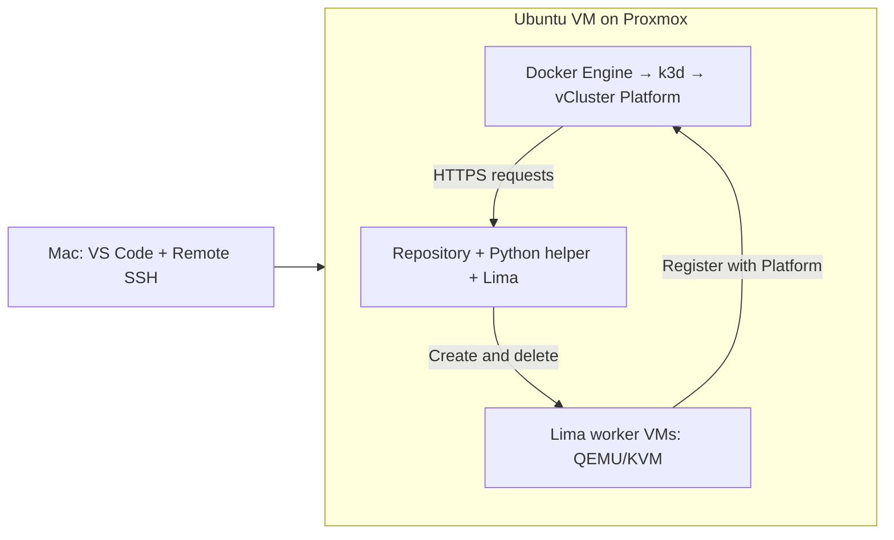

# Linux development lab on Proxmox

Use this guide later to prepare an Ubuntu VM for developing this project's Linux support. Keep VS Code on your Mac and do the development and testing inside the Ubuntu VM over SSH.

**Status on 2026-11-07:** Linux support is planned in [roadmap phase 6](../ROADMAP.md#phase-6--linux-host-support). Creating this lab will give you a place to implement it. The current provider still requires macOS VZ, ARM64 workers and launchd, so installing the repository on Ubuntu alone will not make it provision workers.

## What will run where?

| Location | What runs there | Purpose |
| --- | --- | --- |
| Your Mac | VS Code and Remote SSH | Edit the files stored in Ubuntu and use its terminal. |
| Your Intel Proxmox host | One Ubuntu Server 24.04 x86_64 VM | Provide the Linux development machine. |
| Inside Ubuntu | Docker Engine, k3d and vCluster Platform | Run the Platform that requests workers. |
| Inside Ubuntu, outside Docker | This repository, Python helper, Lima and QEMU | Develop the provider and manage worker VMs. |
| Inside Ubuntu | Lima worker VMs | Join a tenant cluster and run its workloads. |
| OpenAI | The coding model, accessed over HTTPS | Help with development through Codex. |



**k3d** runs K3s Kubernetes nodes as Docker containers. Its nodes host Platform. The separate Lima VMs become tenant workers; they are not extra k3d nodes.

## 1. Create the Ubuntu VM

Create a full VM in Proxmox with Ubuntu Server 24.04 LTS for **amd64/x86_64**. Ubuntu Server is enough because you will use SSH instead of a remote desktop.

Use this as an initial planning budget:

| Setting | Starting point |
| --- | --- |
| CPU | 4 vCPUs, CPU type `host` |
| Memory | 12 GiB |
| Disk | 100 GiB |
| Network | A stable LAN address or DHCP reservation |
| Access | OpenSSH server with your SSH key |

These are estimates for a small lab with two workers using 2 GiB each, not tested minimum requirements. Leave enough memory, CPU and storage for Proxmox and your other workloads. Worker disks also consume space inside the Ubuntu VM's disk.

## 2. Check nested virtualization first

The Ubuntu VM must be able to run its own VMs. This is called **nested virtualization**:

```text
Physical Intel machine → Proxmox → Ubuntu VM → Lima worker VMs
```

On the Proxmox host, check whether Intel nested virtualization is enabled:

```bash
cat /sys/module/kvm_intel/parameters/nested
```

The expected result is `Y` or `1`. Set the Ubuntu VM's CPU type to `host` so it can see the physical CPU's virtualization features. If you change that setting, fully shut down and start the Ubuntu VM.

Inside Ubuntu, inspect:

```bash
lscpu
ls -l /dev/kvm
```

Confirm the VM sees Intel virtualization support and that your development user can read and write `/dev/kvm`. Configure the `kvm` group permissions if needed and reconnect after changing group membership.

Then prove that Lima can start a real QEMU worker-sized VM using KVM. Do this before installing the full Platform stack. Installing Docker successfully does not prove nested virtualization works.

See the [Ubuntu nested virtualization guide](https://ubuntu.com/server/docs/how-to/virtualisation/enable-nested-virtualisation/) and [KVM nested guest documentation](https://www.kernel.org/doc/html/latest/virt/kvm/x86/running-nested-guests.html). If these checks fail, resolve the Proxmox and Ubuntu settings before continuing.

## 3. Install the tools inside Ubuntu

Install these in the Ubuntu VM:

- Git, Python 3.11 or newer and OpenSSL.
- QEMU and Lima for creating the worker VMs.
- Docker Engine for running k3d.
- k3d, kubectl, Helm and the vCluster CLI for the Platform environment.

Use [Docker's Ubuntu instructions](https://docs.docker.com/engine/install/ubuntu/), the [k3d installation guide](https://k3d.io/stable/) and [Lima's installation guide](https://lima-vm.io/docs/installation/). Use Docker Engine directly on Ubuntu. Lima's [QEMU driver](https://lima-vm.io/docs/config/vmtype/qemu/) is the Linux backend.

Run the helper and Lima under the same Ubuntu development user. Keep the repository and private state at stable paths so service restarts can find them.

Record the Ubuntu release, kernel, Lima, QEMU, Docker, k3d and Kubernetes versions. Also record the Platform and tenant chart versions when installed. Pin the versions you validate so the lab can be reproduced.

The Ubuntu **host** release and Ubuntu **worker** image are separate choices. The current helper uses the `ubuntu-22.04` Lima template; using an Ubuntu 24.04 development VM does not require changing that worker image at the same time.

## 4. Clone the repository and run the offline checks

Inside Ubuntu:

```bash
mkdir -p ~/code
cd ~/code
git clone https://github.com/juanroldan1989/vcluster-lima-nodeprovider.git
cd vcluster-lima-nodeprovider
python3 -B -m unittest discover -s tests -v
python3 -B scripts/check_repository.py
```

There is no native compilation step: this project uses Python, shell commands and infrastructure templates.

The tests use fake Lima commands. Passing them gives you a baseline for development; it does not prove that real Linux worker VMs work. The repository review on 2026-11-07 passed all 87 offline tests and the repository checker on the reviewing machine, without a live Linux VM test.

## 5. Connect VS Code from your Mac

1. Install the Remote SSH extension in VS Code on your Mac.
2. Confirm you can SSH into Ubuntu with your development user.
3. In VS Code, run **Remote-SSH: Connect to Host** and select that machine.
4. Open `~/code/vcluster-lima-nodeprovider` on Ubuntu.
5. Install the development extensions offered for the remote SSH environment.

Files, terminals and tests now use Ubuntu. You do not need to install a desktop version of VS Code inside the VM. See [VS Code Remote SSH](https://code.visualstudio.com/docs/remote/ssh).

For coding assistance, use the Codex extension in the remote workspace or Codex CLI in its terminal. An **OpenAI API key** authenticates your coding tool; it is not required by the Lima provider or vCluster Platform.

In the Codex extension, choose **Use API Key** when signing in. API usage is billed through your OpenAI Platform account separately from ChatGPT subscription usage. Store the key through Codex authentication, outside this repository. The model runs at OpenAI, so the Ubuntu VM does not need a local model or GPU. See [official OpenAI authentication guidance](https://learn.chatgpt.com/docs/auth).

## 6. Create k3d and install vCluster Platform

Create a small k3d cluster inside Ubuntu, then install Platform into it using the [Platform Helm installation guide](https://www.vcluster.com/docs/platform/install/helm). Confirm your license or trial includes Auto Nodes and Terraform NodeProviders.

Plan the Platform hostname and HTTP/HTTPS port mappings before creating the cluster. The Platform browser UI must be reachable from your Mac, and its registration endpoint must be reachable from the Lima workers. A browser-only SSH port forward does not establish worker connectivity. See [k3d service exposure](https://k3d.io/stable/usage/exposing_services/).

Keep these two connections separate:

| Connection | What to check |
| --- | --- |
| Platform Pods → helper | They can resolve and reach the helper HTTPS address, trust its certificate and authenticate. |
| Lima workers → Platform | They can resolve and reach the Platform registration hostname. |

k3d provides `host.k3d.internal` for reaching the Docker host, which is Ubuntu in this lab. A candidate helper address is `https://host.k3d.internal:18443`. Verify it from Platform Pods and include that hostname in the helper certificate. Do not assume the macOS default `host.docker.internal` works on Linux. See the [k3d networking FAQ](https://k3d.io/stable/faq/faq/).

Also keep LAN, Docker, k3d, Lima and tenant network ranges from overlapping.

## 7. Implement Linux support in small steps

Use [roadmap phase 6](../ROADMAP.md#phase-6--linux-host-support) as the implementation checklist:

1. Select QEMU on Linux while retaining VZ on macOS.
2. Select the matching guest image and architecture. Lima calls x86_64 `x86_64`; Kubernetes calls it `amd64`. Lima's `aarch64` corresponds to Kubernetes' `arm64`.
3. Make the NodeProvider advertise the architecture the helper actually creates.
4. Configure and test both network connections described above.
5. Start the helper in the foreground and prove one worker can join and be deleted.
6. Add systemd user-service start, stop and status commands. Check that ownership records survive helper restarts. Keep launchd working on macOS.
7. Test two workers, their network connectivity and tenant autoscaling.
8. Add Linux acceptance checks, macOS regression checks and a tested compatibility record.

The existing foreground entry point is `python3 -m helper.server --config PATH_TO_CONFIG`. It requires prepared configuration and private credentials. Foreground mode avoids service management, but it still needs the Linux VM-creation changes before it can provision workers.

The current `./setup.sh start` requires macOS. Treat the existing [installation guide](installation.md) as a reference for the lifecycle until Linux support is implemented.

## 8. Validate the complete lifecycle

Start with one worker, then repeat the [autoscaling example](../examples/autoscaling/README.md) on Linux:

- Provision one worker and confirm the Kubernetes Node becomes Ready.
- Increase workload demand and confirm a second worker becomes Ready.
- Confirm workload Pods run on the expected workers.
- Reduce demand and confirm automatic removal of an unneeded worker and its Lima VM.
- Restart the helper and confirm it still recognizes its workers.
- Delete the tenant through Platform and confirm all its claims, ownership records and Lima VMs are removed.

For this first small lab, plan a shared helper/provider limit of two workers and a tenant pool limit of two. Preserve all three controls: tenant pool, NodeProvider and helper. Increase them only after checking available host capacity.

Record actual results and versions using the [existing validation record](autoscaling-validation.md) as a model. Keep offline test results separate from real VM validation.

## 9. Clean up in the right order

Remove tenants and their managed workers through Platform while the helper is still running. Confirm the managed VMs and ownership records are gone, then remove the provider, stop the helper and remove Platform or k3d.

Keep private credentials, generated manifests and ownership state outside tracked source files. Preserve the state directory across helper restarts. Removing a VM manually while Platform still owns its claim can leave the lab out of sync.

## Checklist for later

- [ ] Ubuntu Server 24.04 x86_64 VM created on Proxmox.
- [ ] Nested KVM works and the development user can access `/dev/kvm`.
- [ ] Lima can start and remove a real QEMU test VM.
- [ ] Repository cloned and offline checks pass inside Ubuntu.
- [ ] VS Code Remote SSH and Codex authentication work.
- [ ] Docker Engine, k3d and vCluster Platform are installed.
- [ ] Platform-to-helper and worker-to-Platform connections work.
- [ ] Linux provisioning, architecture selection and systemd support are implemented.
- [ ] One-worker lifecycle, two-worker autoscaling and restart recovery pass.
- [ ] Managed VM cleanup is confirmed and tested versions are recorded.
