# Tenant autoscaling example

Run an nginx Deployment in the `lima-demo-a` vCluster tenant and observe it provision and retire its Lima workers as demand changes.

The same provisioning and removal lifecycle applies as you add more tenants. Each tenant has its own control plane and private workers, while all tenants using this installation share the NodeProvider and Mac helper capacity limits. More tenants do not increase that shared capacity: worker creation remains subject to each tenant pool's limits, the available NodeProvider slots and the CPU, memory and disk resources of the machine running this local lab, including vCluster Platform.

This is a live lab: the commands create a real tenant and VMs. Read the [installation prerequisites](../../docs/installation.md#prerequisites) first. Run commands from the repository root.

The commands, screenshots and recording below use **`lima-demo-a`**, captured on 2026-11-07. See [capture metadata](#screenshot-capture-metadata) for the tested environment and capture details.

## What the example demonstrates

| Stage | Ready replicas | Expected workers | Managed VMs for this tenant |
| --- | --- | --- | --- |
| Baseline | 1 | 1 | 1 |
| Scale up | 2 | 2 | 2 |
| Scale down | 1 | 1 after consolidation | 1 |
| Delete tenant | — | 0 | 0 |

Scheduling and disruption constraints can retain workers. The scale-down checks below distinguish Pod removal, Kubernetes Node removal, NodeClaim deletion and actual VM deletion. A single successful observation is not a guarantee of an exact node count in every environment.

## 1. Prepare the shared capacity budget

Use the [setup commands](../../docs/installation.md#prepare-and-deploy) with this profile:

```bash
./setup.sh prepare --platform-host YOUR-PLATFORM-HOSTNAME \
  --cpus 1 --memory-gib 2 --disk-gib 30 \
  --max-nodes 4 --pool-nodes 2
./setup.sh start
./setup.sh check
./setup.sh deploy
```

<a name="platform-nodeprovider"></a>

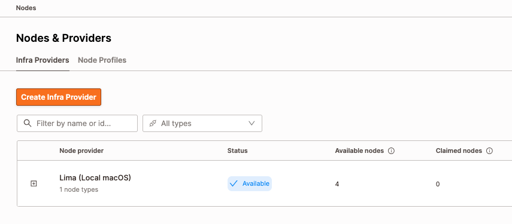

*The Lima provider is Available with four free worker slots and zero claimed nodes. This idle view was captured after tenant cleanup.*

<a name="lima-auto-template"></a>

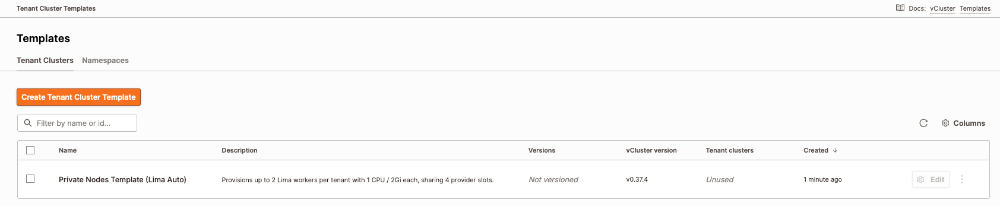

*The installed template targets vCluster 0.37.4 and advertises two 1-CPU / 2Gi workers per tenant within four shared provider slots.*

Use the generated manifest for the template configuration.

Preparation is intended for a fresh installation or one whose managed workers have already been removed. It refuses configuration changes while ownership records remain. Use your complete settings if you change the defaults.

The commands below use these names. Substitute your own host context, project or connected cluster if needed:

| Setting | Example value |
| --- | --- |
| Host kubectl context | `k3d-host-cluster` |
| Platform namespace | `vcluster-platform` |
| Platform project | `default` |
| Project namespace | `p-default` |
| Connected cluster in Platform | `loft-cluster` |
| NodeProvider | `lima-local` |
| Tenant template | `private-nodes-lima-auto` |
| Tenant | `lima-demo-a` |

### The three capacity controls

| Control | Generated setting | Scope and effect |
| --- | --- | --- |
| Tenant pool | `limits.nodes: "2"`, `cpu: "2"`, `memory: 4Gi` | Each tenant can request two 1 CPU / 2Gi workers. These are aggregate worker capacities, before Kubernetes overhead. |
| NodeProvider | Node type `maxCapacity: 4` | Platform's shared capacity setting for this node type across tenants. This provider exposes one worker shape. |
| Mac helper | `max_nodes: 4` | The helper checks its ownership reservations and all `vclima-*` VMs in its Lima inventory before accepting another VM. |

`--max-nodes` configures both the NodeProvider and helper. `--pool-nodes` generates the per-tenant node, CPU and memory limits. This tenant can therefore request at most two workers within the four shared provider slots. Other tenants using this installation consume the remaining shared slots; the limit is not a reservation for each tenant.

This example uses at most **2 CPUs / 4Gi RAM / two 30Gi virtual disks** for its workers. The full shared budget of four workers represents **4 CPUs / 8Gi RAM / four 30Gi virtual disks**. This does not reserve host resources or account for Docker, macOS and unrelated VMs. The helper excludes unrelated VM names from its count; choose a budget your Mac can support. Use one helper for the shared budget.

## 2. Create the tenant

Ensure your [project allows the template](../../docs/installation.md#1-allow-the-template-in-your-project), then create `lima-demo-a`:

```bash
vcluster create lima-demo-a --driver platform \
  --template private-nodes-lima-auto \
  --project default --cluster loft-cluster --connect=false
```

The tenant has its own control plane, Kubernetes API and worker membership. Its workers belong to this tenant rather than a shared Kubernetes node pool. Tenant system Pods may request an initial worker before the application is deployed.

<a name="default-project-tenants"></a>

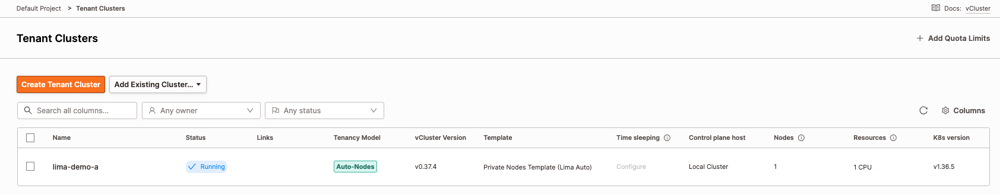

*Tenant A is Running on vCluster 0.37.4 with one worker and Kubernetes v1.36.5.*

### Creation checkpoints: Starting, pending first claim and control-plane availability

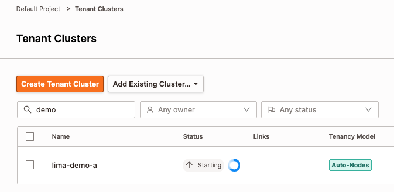

*Tenant A is Starting with Auto-Nodes tenancy while Platform creates its control plane.*

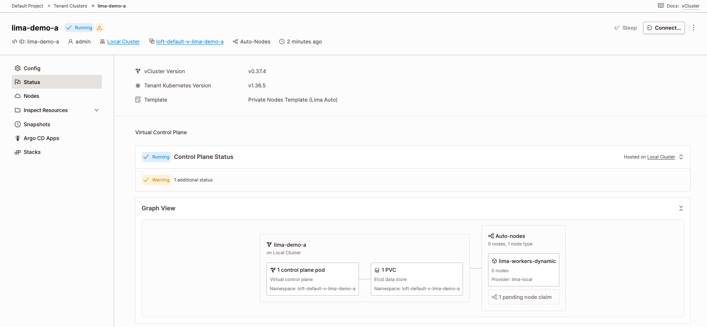

*The hosted control plane and PVC exist while the first worker claim is pending. Control-plane availability precedes worker readiness.*

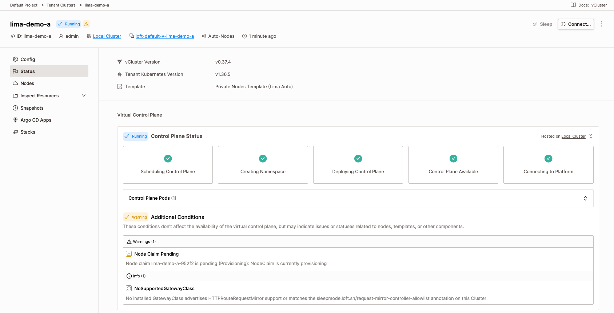

*The Node Claim Pending condition reports provisioning for lima-demo-a-952f2. The control-plane steps have completed while the worker is being prepared.*

### Save a private kubeconfig

Export a kubeconfig for `lima-demo-a` so later commands target the tenant without switching your current context:

```bash
umask 077
mkdir -p .local/autoscaling
chmod 700 .local/autoscaling

vcluster connect lima-demo-a --driver platform --project default --print --background-proxy=false \
  > .local/autoscaling/lima-demo-a.kubeconfig

chmod 600 .local/autoscaling/lima-demo-a.kubeconfig
```

This file contains credentials. Keep it in ignored `.local/` and do not paste its contents into an issue or validation record. The [vCluster connect reference](https://www.vcluster.com/docs/vcluster/cli/vcluster_connect) documents `--print` and command execution options.

## 3. Deploy one replica in the tenant

Apply [workload.yaml](workload.yaml) to `lima-demo-a`:

```bash
kubectl --kubeconfig .local/autoscaling/lima-demo-a.kubeconfig apply -f examples/autoscaling/workload.yaml

kubectl --kubeconfig .local/autoscaling/lima-demo-a.kubeconfig -n default rollout status deployment/lima-scale-test --timeout=15m
```

| Container setting | Value | Purpose |
| --- | --- | --- |
| Image | `nginx:1.28-alpine` | Small HTTP application with an HTTP readiness probe. |
| CPU request | `600m` | One Pod fits a 1-CPU worker; two require `1200m` and cannot share one. |
| Memory request | `128Mi` | Small reservation suitable for a local lab. |
| CPU limit | `750m` | Runtime CPU ceiling for the container. |
| Memory limit | `256Mi` | Runtime memory ceiling for the container. |

The scheduler uses requests to place Pods. This example needs no CPU stress generator: two idle nginx Pods still reserve more CPU than one worker provides. See [Kubernetes resource requests and limits](https://kubernetes.io/docs/concepts/configuration/manage-resources-containers/) for the scheduling distinction.

Confirm one Ready application Pod and one Ready worker in the tenant:

```bash
kubectl --kubeconfig .local/autoscaling/lima-demo-a.kubeconfig -n default get pods -l app=lima-scale-test -o wide
kubectl --kubeconfig .local/autoscaling/lima-demo-a.kubeconfig get nodes -o wide
```

<a name="lima-demo-a-overview"></a>

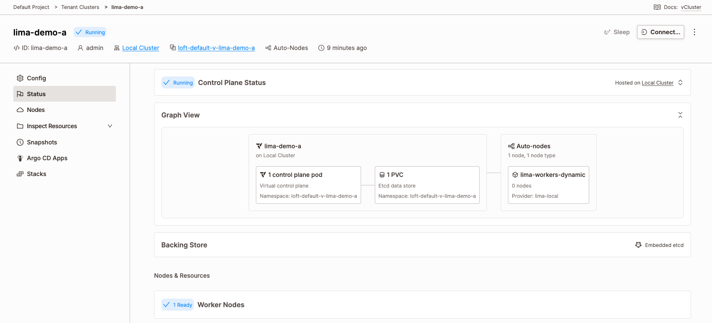

*The overview connects the hosted control plane and PVC to the Lima Auto Nodes pool. The worker summary reports one Ready worker.*

<a name="lima-demo-a-nodes-baseline"></a>

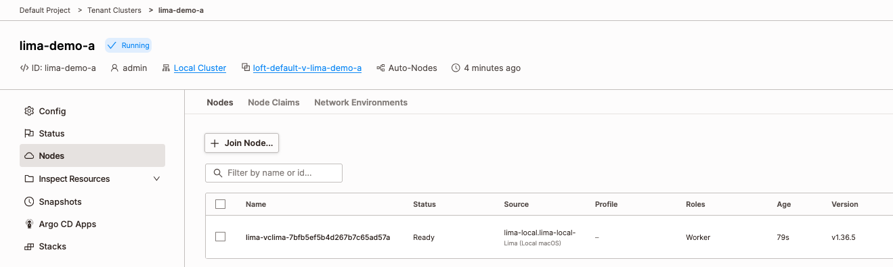

*The initial Lima worker is Ready and running Kubernetes v1.36.5. Its name can be matched to the original VM inventory.*

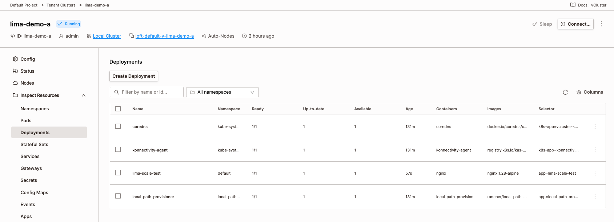

*The lima-scale-test Deployment has one Ready and available nginx replica alongside the tenant system Deployments.*

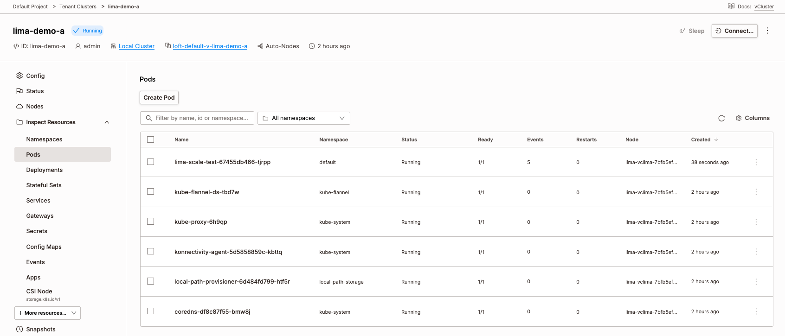

*The baseline nginx Pod is Running and Ready. The Node column shows its placement on the initial Lima worker.*

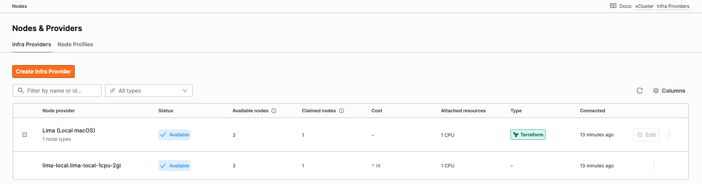

*One Lima worker is claimed and three of the four shared slots remain available. The expanded row identifies the provider-qualified worker type.*

## 4. Scale up the tenant

```bash
kubectl --kubeconfig .local/autoscaling/lima-demo-a.kubeconfig -n default scale deployment/lima-scale-test --replicas=2
```

Observe provisioning while the second worker is being requested, before waiting for the rollout to finish:

<a name="nodeclaims-provisioning"></a>

### Additional scale-up checkpoints: Pending Pod and worker registration

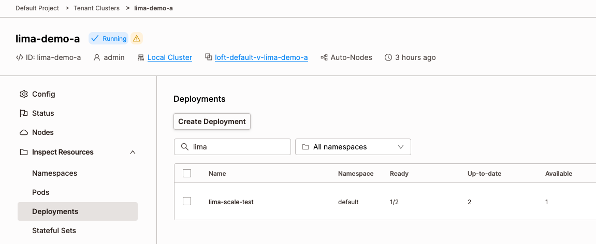

*The Deployment now requests two replicas, but only one is Ready while additional worker capacity is provisioned.*

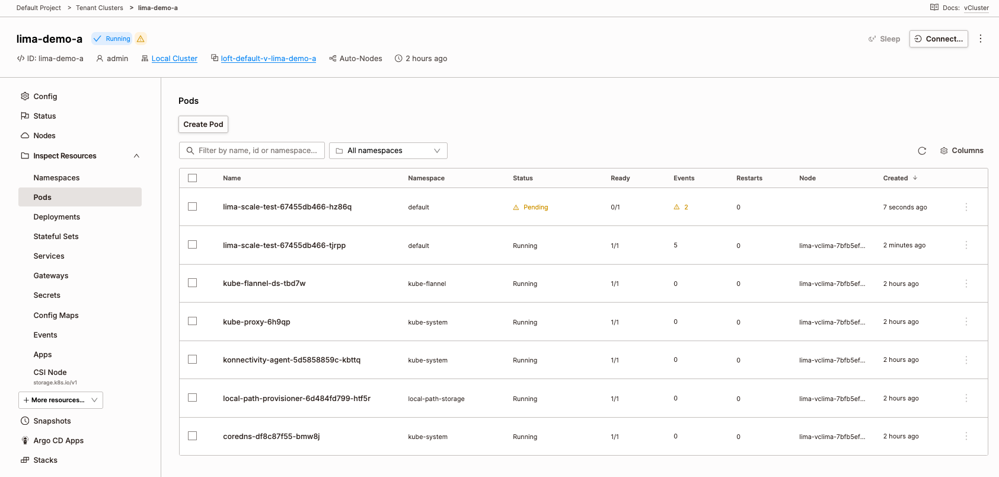

*The additional nginx Pod is Pending without an assigned node. Its CPU request cannot fit alongside the original replica on one worker.*

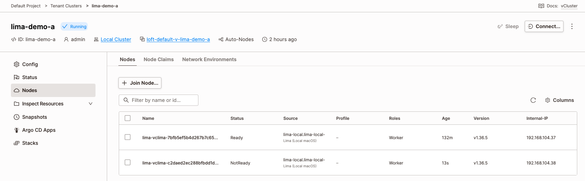

*The new worker is registered in the tenant but still NotReady. Registration and Kubernetes readiness are separate checkpoints.*

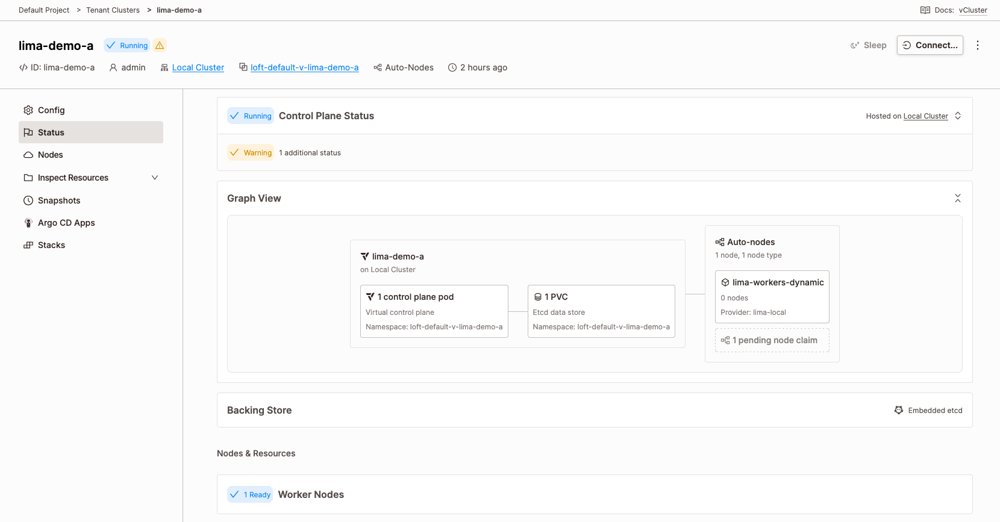

*The original worker remains Ready while Auto Nodes requests another worker to satisfy the Pending Pod.*

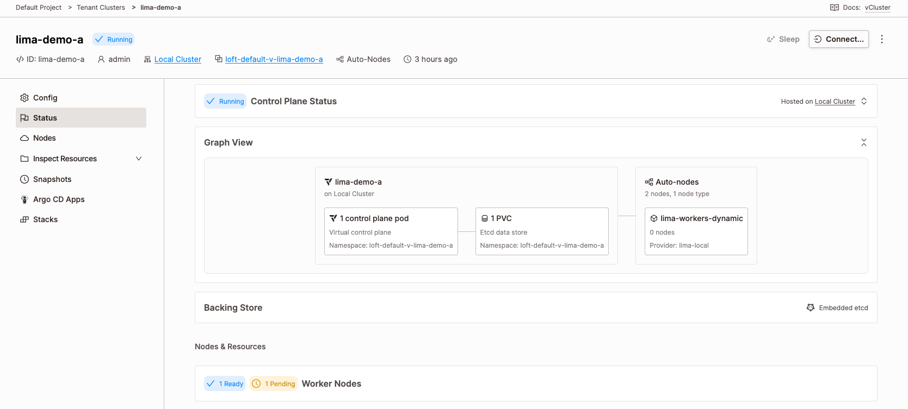

*The second worker has entered the joining flow. The summary shows one Ready worker and one Pending worker.*

Then wait for application readiness:

```bash
kubectl --kubeconfig .local/autoscaling/lima-demo-a.kubeconfig -n default rollout status deployment/lima-scale-test --timeout=15m
```

Repeat the Pod and Node checks. The tenant should now have two Ready replicas on separate workers.

<a name="lima-demo-a-nodes-scaled-up"></a>

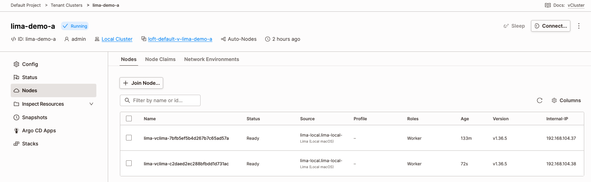

*Both worker rows are Ready, with distinct names and internal IP addresses.*

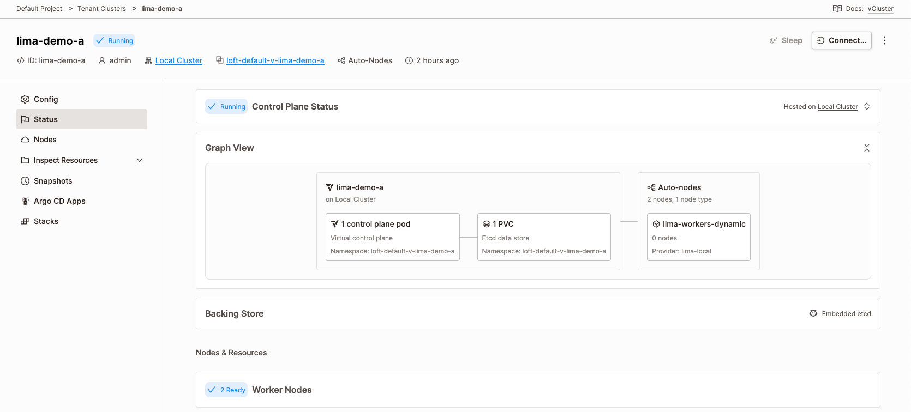

*The worker summary reports two Ready workers after the additional claim completes.*

<a name="lima-demo-a-deployment"></a>

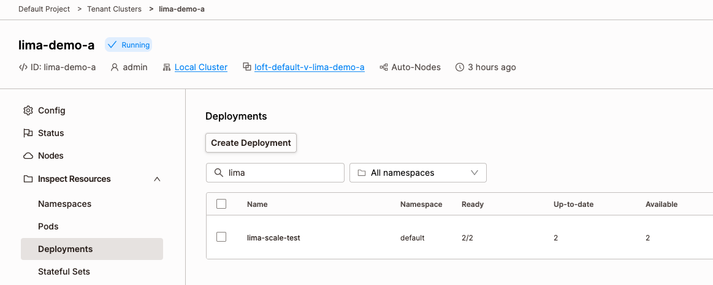

*Scale-up has completed: both desired nginx replicas are Ready and available.*

<a name="lima-demo-a-pods"></a>

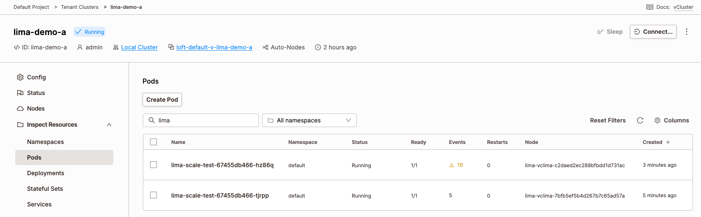

*Both nginx replicas are Running and Ready. Their Node column values confirm that each replica uses a different worker.*

Also inspect the host-side claims and the actual VM inventory:

```bash
./setup.sh status
kubectl --context k3d-host-cluster -n p-default get nodeclaims.storage.loft.sh
limactl list --format '{{.Name}} {{.Status}}'
```

Record which NodeClaims belong to `lima-demo-a` and which VM belongs to each claim. The helper's private ownership records provide this mapping without containing bootstrap payloads:

```bash
python3 - <<'PY'
import json
from pathlib import Path

for path in sorted(Path('.local/nodes').glob('*.json')):
    record = json.loads(path.read_text())
    print(record['tenant'], record['claim'], record['vm_name'], 'bootstrap-complete=' + str(record['ready']))
PY
```

Use your configured ownership path if you changed `--state-dir`. Keep the VM names for the scale-down check. The inventory may also contain unrelated VMs; only count the VMs mapped to `lima-demo-a`.

<a name="nodeclaims-available"></a>

Use the host-side commands above to correlate Platform claims with tenant worker names.

<a name="helper-status"></a>

Use `./setup.sh status` and the private ownership mapping above to verify the shared cap and claim-to-VM identities.

<a name="lima-vms-scaled-up"></a>

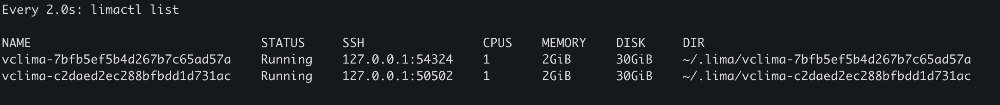

*Lima lists the two original worker VMs as Running, each with 1 CPU, 2GiB RAM and a 30GiB virtual disk.*

## 5. Reduce demand and verify VM removal

```bash
kubectl --kubeconfig .local/autoscaling/lima-demo-a.kubeconfig -n default scale deployment/lima-scale-test --replicas=1
```

Wait for the Deployment to return to one Ready replica. Then repeat the tenant Node checks, host NodeClaim listing, helper status and Lima inventory listing.

For each retired worker, confirm all four observations:

1. Its Kubernetes Node disappears from the tenant.
2. Its Platform NodeClaim disappears from `p-default`.
3. Its helper ownership record disappears.
4. Its exact `vclima-*` VM name is absent from `limactl list`.

Auto Nodes initiates removal; Platform destroys the managed OpenTofu resource and the helper deletes its owned VM. Do not manually delete a Lima VM to claim that automatic scale-down succeeded.

<a name="lima-demo-a-nodes-scaled-down"></a>

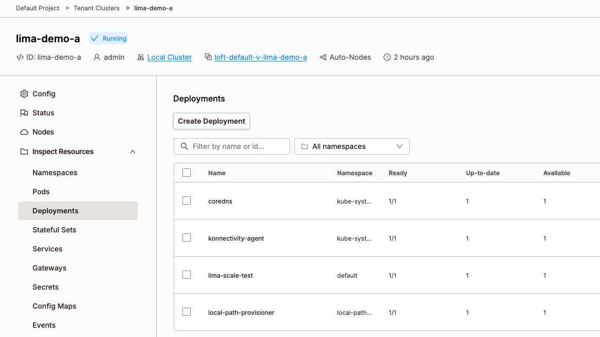

*The Deployment view shows the reduced one-replica application state with one Ready and available nginx replica.*

<a name="nodeclaims-scaled-down"></a>

The [occupied-worker consolidation results](../../docs/autoscaling-validation.md#occupied-worker-consolidation) confirm that the retired Node, Platform claim, ownership record and exact VM were removed.

<a name="lima-vms-scaled-down"></a>

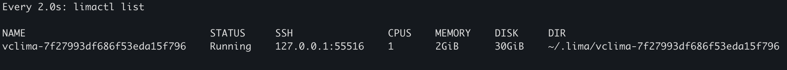

*After scale-down, one Lima worker VM remains Running with 1 CPU, 2GiB RAM and a 30GiB virtual disk.*

If a worker remains after demand falls, follow [scale-down troubleshooting](../../docs/troubleshooting.md#if-an-occupied-worker-remains) for type-label checks, disruption constraints and an optional empty-worker test.

## 6. Tear down before removing Platform

Keep Platform available while removing the complete installation. This includes every tenant using its template or associated provider claims, so preview the scope if the provider serves additional tenants:

```bash
./setup.sh teardown --dry-run
./setup.sh teardown

kubectl --context k3d-host-cluster get virtualclusterinstances.storage.loft.sh -A
kubectl --context k3d-host-cluster -n p-default get nodeclaims.storage.loft.sh
limactl list --format '{{.Name}} {{.Status}}'
```

Teardown keeps the helper running until managed VM cleanup completes, then removes the provider resources, stops the helper and removes generated local files. `status` requires a prepared configuration, so the checks afterward use the host API and Lima directly.

Confirm `lima-demo-a` is gone and none of its claims, ownership records or mapped VMs remain. Unrelated tenants and manually managed VMs can remain in the output.

<a name="default-project-teardown"></a>

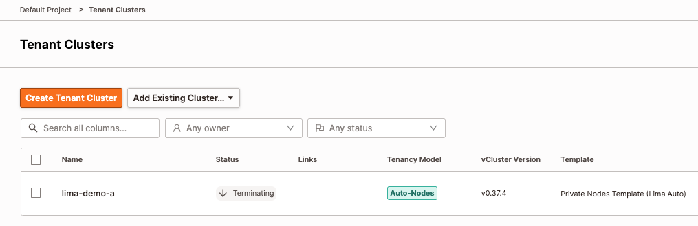

*Platform shows tenant A as Terminating while its control plane, storage and remaining worker are being cleaned up.*

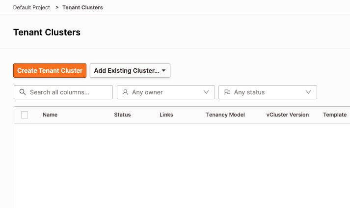

*Tenant A is absent from the Default project after managed tenant deletion completes.*

<a name="nodeclaims-teardown"></a>


*After tenant deletion, the provider remains Available with zero claimed nodes and all four slots free. Full installation teardown removes the provider afterward.*

<a name="lima-vms-teardown"></a>

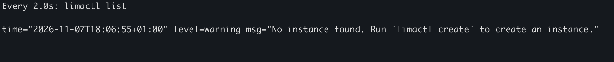

*The selected Lima inventory reports No instance found after tenant deletion, confirming that no VM remains in that inventory.*

See [Cleanup before removing Platform](../../docs/installation.md#cleanup-before-removing-platform) for the normal cleanup order and reinstallation steps. For legacy resources or interrupted cleanup, use the [troubleshooting guide](../../docs/troubleshooting.md#scenario-index).

## Provider teardown recording

The capture session deleted tenant A first, then ran `./setup.sh teardown` to remove the provider, template, credentials and local helper. A single teardown command can also remove the complete installation, as shown above.

[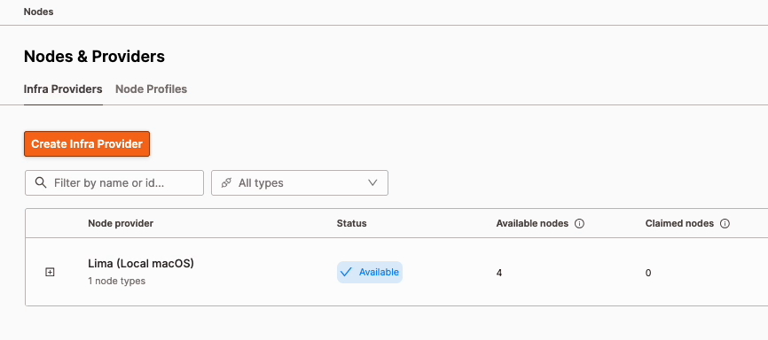](../../docs/images/screenshots/lima-node-provider-removed-by-teardown-script.mp4)

*Watch the 4.2-second recording: the idle provider disappears from Nodes & Providers during full installation teardown. [Open MP4](../../docs/images/screenshots/lima-node-provider-removed-by-teardown-script.mp4) · [Original MOV](../../docs/images/screenshots/lima-node-provider-removed-by-teardown-script.mov).*

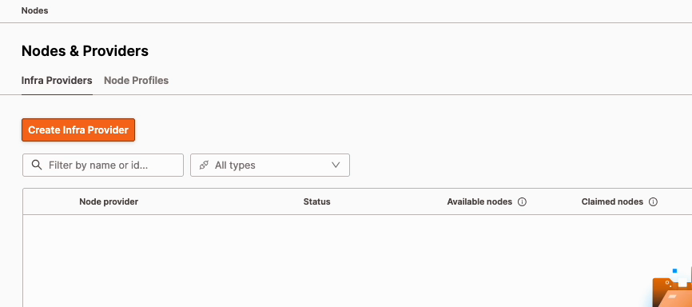

*At approximately 3.2 seconds in the recording, the provider row has disappeared. This frame is extracted from the original footage.*

## Screenshot capture metadata

The captures show tenant A during provisioning, scaling and cleanup on 2026-11-07.

| Field | Capture value |
| --- | --- |
| Capture date and scope | 2026-11-07, Europe/Amsterdam; lima-demo-a |
| Host OS and CPU architecture | macOS, ARM64 |
| vCluster Platform | 4.12.4 |
| Tenant chart / Kubernetes | 0.37.4 / v1.36.5 |
| vCluster CLI / Lima | 0.37.4 / 2.1.0 |
| Provider / template | `lima-local` / `private-nodes-lima-auto` |
| Worker profile | 1 CPU / 2Gi RAM / 30Gi disk |
| Capacity limits | Four shared workers; two workers / 2 CPUs / 4Gi per tenant |
| Recording | 4.193 seconds, 866 × 384; original MOV plus MP4 playback copy |

The [asset catalog](../../docs/images/screenshots/README.md) describes the screenshots and recording formats. The [validation record](../../docs/autoscaling-validation.md) documents the observed autoscaling results.

### Reused display locations

| Capture | Additional display locations |
| --- | --- |
| Idle / claimed provider | [README showcase](../../README.md#screenshot-showcase), [installation](../../docs/installation.md#4-deploy-the-provider-and-inspect-its-status), [helper lifecycle](../../docs/local-helper.md#platform-integration) |
| Template catalog | [Installation template defaults](../../docs/installation.md#template-defaults) |
| Dynamic pool configuration | [Type-selector troubleshooting](../../docs/troubleshooting.md#instance-type-not-found) |
| Baseline worker | [Installation worker readiness](../../docs/installation.md#4-confirm-readiness-inside-the-tenant) |
| Ready Pods and VM inventories | [README showcase](../../README.md#screenshot-showcase), [validation record](../../docs/autoscaling-validation.md#screenshot-references) |
| Teardown recording | [README showcase](../../README.md#screenshot-showcase), [installation cleanup](../../docs/installation.md#cleanup-before-removing-platform) |

## Troubleshooting

Use the [scenario index](../../docs/troubleshooting.md#scenario-index) for provisioning delays, Pending Pods, capacity limits, interrupted runs and cleanup issues. The [autoscaling validation record](../../docs/autoscaling-validation.md) documents the observed environment and results.
